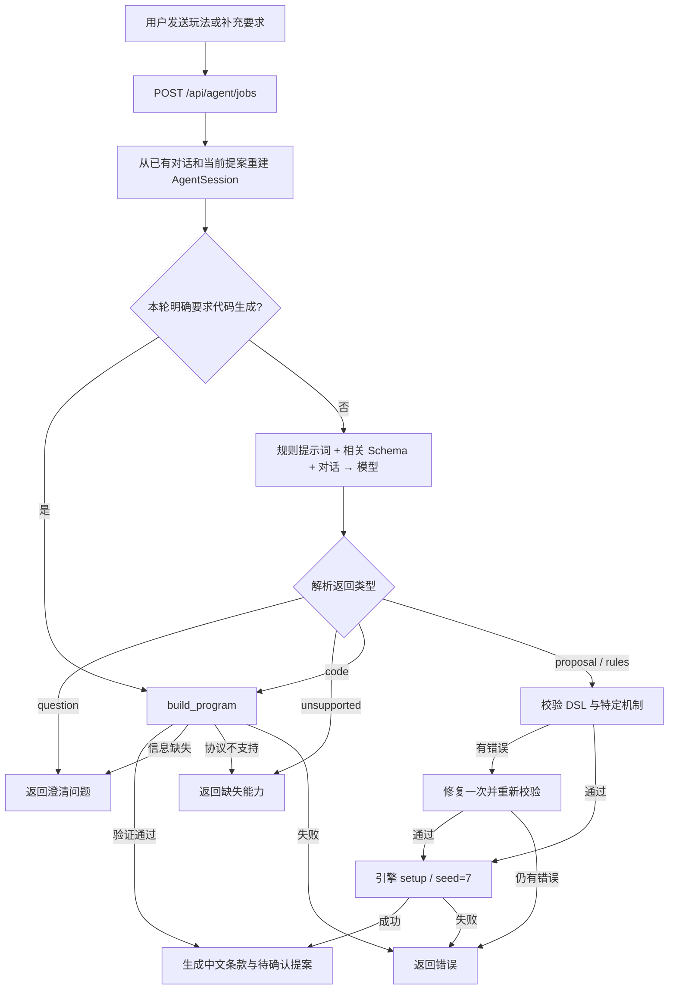

# Agent 是怎么运作的

本文与 [项目架构](architecture.md) 配套，描述当前源码实现。

这里的 Agent 负责把自然语言变成可以执行的游戏定义：它获取对话上下文，请模型澄清或提出实现方案，用本地校验器和引擎检查结果，必要时把错误交回模型修复。试玩里的电脑玩家由游戏引擎执行合法动作策略，正常出牌不再参与这段模型交互。

## 1. Agent 由哪些部分组成

| 通常所说的 Agent 能力 | 本项目的具体实现 |
| --- | --- |
| 接收目标 | 用户最新的 `message` 和已有的 `messages` |
| 记住上下文 | 浏览器保存历史和当前 `proposal`，每次 HTTP 请求重新传给服务端 |
| 理解与选择路径 | Python 的局部关键词识别 + `CONTRACT` 提示词 + 模型返回的 JSON 类型 |
| 调用能力 | 宿主直接调用 `validate_dsl()`、`create_engine()`、`build_program()` 和 QuickJS 验证器 |
| 获取反馈 | 字段错误、机制不符、固定测试失败、非法状态、模拟超时等具体错误 |
| 修复 | DSL 最多一次修复；代码生成有独立的合约修复与源码修复循环 |
| 结束一次任务 | `question`、`unsupported`、`proposal` 或 `error`，交回页面与用户 |

这些阶段由显式 Python 控制流编排。同一 `ModelClient` 被用于理解、制定合约和编码，没有独立运行的规划/编码/评审多 Agent。当前 SDK 请求没有发送 `tools` 或消费 `tool_calls`；模型返回 `type=code` 后，是宿主调用构建器。项目也没有向量检索记忆、长期自主任务循环或在线训练流程。

## 2. 一次“发送”真正经过哪里



[main.tsx](../frontend/src/main.tsx) 的 `ask()` 把 `message`、`messages` 和 `proposal` 发给后台任务接口；普通 DSL 对话也使用这个接口，并不只有代码生成才创建 job。

[api.py](../src/pocker_agent/api.py) 在接收任务时读取正式模型配置，创建客户端，再交给 `BuildJobs.start()`。任务线程执行 `generate()`，临时构造 `AgentSession`，调用 `RuleAgent.turn()`，最后返回更新后的对话、规则、中文条款、验证合约和构建记录。同步 `/api/agent/turn` 使用同一个 `generate()`。

任务最多同时运行一个，另一份请求会被拒绝，不会自动排队。开始新任务时清理超过一小时的历史，并把记录总量限制在 20 条以内。页面通常每秒查询一次进度，网络错误时每三秒重试；刷新后使用保存的任务 ID 继续查询。后端重启导致任务 ID 失效时，页面提示重新发送，不能续接已经中断的模型调用。

## 3. 上下文如何组织

`RuleAgent.turn()` 先把最新用户消息加入 `session.messages`，再选择路径。普通规则请求的消息组合是：

```text
system: CONTRACT + 本次选择的 JSON Schema
user:   当前规则草案（如果存在）
user/assistant: 已有对话记录
user:   本轮新要求
```

模型输出 `question` 时把问题加入历史；输出内置提案时，宿主把由最终规则生成的摘要及规则 JSON 加入历史。源码修复也带上原始用户对话，降低局部修复丢失原始要求的可能。

`turns` 是页面展示的对话，`messages` 是下轮提交给模型的上下文，两者用途不同。记忆保存在浏览器 localStorage，不在 `RuleAgent` 对象或后端对话数据库中。请求允许最多 60 条历史、每条最多 40000 字符、最新输入最多 8000 字符；代码没有自动摘要或裁剪超长历史的机制。

当前实现修改玩法的处理有明确时点：任务执行期间页面阻止继续操作；收到任务的正常业务结果后取消旧确认并清空衍生显示。`question`、`unsupported` 或业务 `error` 通常没有 `rules`，所以也会清空页面提案。后台异常失败则只结束 pending，保留原草稿，允许重试。

## 4. 内置规则路径：模型负责填写，引擎负责执行

[agent.py](../src/pocker_agent/agent.py) 的 `_expected_family()` 对清晰出现的 24 点/算式、21 点/blackjack、疯狂八名称做局部识别，并过滤部分否定表达。明确比大小时选择旧版 schema；修改已有提案时可沿用其 `kind`。这些是缩小 schema 和拦截明显机制错配的辅助规则，不是完整的自然语言语义解析器。

玩法明确时，`_system_prompt()` 只附带对应内置规则模型的 JSON Schema；不明确时附带所有内置 schema，模型结合能力说明追问。它不会把插件源码 schema 塞进普通规则路由提示词。

模型输出由 `parse_object()` 解析：接受 JSON 对象或完整 JSON 代码围栏；无效 JSON、非对象输出会报错，不从混杂文字中猜测截取。当前主要依靠提示词和应用侧解析约束 JSON，并未在普通 Agent 调用中强制传入 SDK `response_format`。

获得候选规则后依次执行：

1. `validate_dsl()` → `parse_rule()` → Pydantic：验证字段类型、额外字段、动作引用、牌组容量以及玩法专属约束。
2. 若本轮明确识别到某玩法，检查模型返回的 `kind` 是否一致。例如请求 24 点却给出比大小，要进入错误/修复路径。
3. 有上述错误时调用 `_repair()` 一次，把候选规则、错误和用户对话一起交给模型，再校验修复结果。
4. 校验通过后执行 `create_engine(rules, seed=7).setup()`，捕获真实启动错误。
5. 用 `rule_facts(rules)` 从最终执行配置生成中文条款，保存提案并返回页面待确认。

内置提案并不在这个阶段自动跑完整多种子模拟。启动失败会直接返回错误，不再自动修复；第一次模型输出根本不是有效 JSON 时，也还没有进入 DSL 修复阶段。固定规则路径的完整模拟由后续 `/api/simulations` 单独执行。

示例：用户要“无下注 21 点，对庄家，三轮，庄家软 17 停牌”，Agent 应产出 `kind=blackjack`、`max_rounds=3`、`dealer_hits_soft_17=false` 等配置。A 的 1/11、要牌、停牌及胜负判断由 `BlackjackEngine` 完成，不由模型逐张判定。

## 5. 代码生成路径：先定测试，再写源码

本轮输入明确包含“使用代码生成”“用代码生成”或“自己编写代码”等触发词时直接进入 `_build()`；否则由普通路由模型返回 `type=code` 后进入。仅存在旧插件提案不会强制把新请求锁在插件路径。

构建器 [plugin_builder.py](../src/pocker_agent/plugin_builder.py) 有两段独立循环：

| 阶段 | 模型输入与输出 | 宿主检查 | 次数上限 |
| --- | --- | --- | --- |
| 制定行为合约 | 用户对话、旧提案、`PLAN_PROMPT` → `PluginPlan` 或澄清/不支持 | schema、测试牌合法性、预期状态结构、重复/凭空产生牌等可检测矛盾 | 初次 + 最多 2 次合约修复 |
| 编写与修复源码 | 固定 plan、原始用户要求、`PROTOCOL` → 完整 `source` | 固定场景、整局模拟、确定性重复运行、结构属性 | 初次 + 最多 2 次源码修复 |

计划固定 2–4 人、单局、至少 3 个且最多 8 个单步场景，分别覆盖核心动作、回合转换、终局等。每个场景先定义局部状态、合法 `action_id`、目标状态字段及期望值。宿主确认计划结构可接受后，才把计划交给编码模型。

编码失败会把实际错误及上次源码加入对话。这个阶段只允许替换源码，已经确定的合约和测试不随源码修复改变。三份源码仍不通过就返回错误，不返回可玩版本。模型通信失败不等同于测试失败，也不保证会消耗完所有源码修复次数。

构建器对真实模型客户端开启流输出，默认给出低思考强度与 12000 token 输出长度提示；服务拒绝相应可选参数时客户端会做兼容性重试并报告原因。页面看到的是累计字符数和构建阶段，不是把未完成源码实时安装为游戏。流必须完整结束；`finish_reason=length` 等截断结果不会被当作有效源码使用。后台接口把客户端单次模型调用超时设为 180 秒，同步接口默认 90 秒；多轮构建可以长于一次调用的超时，这不是整个 job 的总时限。

有一个窄的复用分支：用户仅要求修改说明，模型返回 `reuse_source=true` 时，只允许变更 `title/description/requirements`。其他执行字段和场景必须与旧程序完全相同，宿主复用原源码并重新验证。这能避免修正文案时无意中重写游戏逻辑。

## 6. 生成代码怎样获得“可玩”资格

每次执行由 Python 宿主启动 worker，通过标准输入发送 JSON；worker 在 QuickJS 中加载源码，调用函数后返回 JSON。每次函数调用都创建新 VM，因此牌局只能通过显式 `state` 延续，不能依靠闭包和全局变量记住上一回合。

`verify_plugin_report()` 运行两类检查：

1. 模型制定的固定场景：先验证当前合法动作包含场景要求的 ID，再执行一步，检查指定路径的期望值。
2. 宿主定义的通用属性：用 seed `0/7/23` 各执行完整对局，每个 seed 再执行一遍并比较完整轨迹；检查每帧牌张守恒、玩家数量、动作格式/唯一性、结束与赢家一致性、目标牌位置、非终局至少有动作、终局没有动作，并核对轨迹中发出的动作属于前帧合法动作。

这里的确定性重放是同一 seed 重跑整条模拟轨迹；当前最后的逐帧检查核对动作合法性，没有额外逐条独立调用 `step()` 来重算每个转换。自动检查不会证明所有动作分支或所有自然语言含义。

报告将结果分开保存：`scenario=passed`、`properties=passed`，而通用检查器的 `independent_oracle` 仍是 `not_available`、`browser` 仍是 `not_run`。模型可能同时误解需求并写出与误解一致的测试；因此还需用户核对和独立语义验收。仓库的 [verify_old_maid.py](../scripts/verify_old_maid.py) 是另外执行的人工规则 oracle，不被生成器或运行时调用。

插件提案显示的 `requirements` 来自模型制定的合约，不是从 JavaScript 自动反向推导出的完整规则说明。内置 `rule_facts()` 由配置生成也只覆盖已实现的条款描述；解释行为发生争议时，需共同核对 schema、执行器及实际轨迹。

`PluginEngine.setup()` 和 `run()` 经 `accepted_program()` 验证门槛，结果按完整序列化规则缓存。这使直接提交插件创建牌局的请求也要通过测试。恢复已有保存状态使用 `restore_engine()`，不会把恢复流程重新当成生成任务；后续插件执行仍校验返回状态。

## 7. 试玩时的“电脑”如何行动

| 玩法 | 默认自动行动 |
| --- | --- |
| v0.1 阶段玩法 | 第一个合法动作；出/弃牌默认从手牌下标 0 开始 |
| 24 点模拟 | 精确求解器找表达式，有解则提交，无解则声明无解 |
| 21 点模拟 | 玩家小于 17 要牌，否则停牌；庄家按配置在结算逻辑中行动 |
| 接牌 | 第一个合法动作与首张可出牌；万能牌优先指定剩余手牌最多的花色 |
| 生成式插件试玩 | 在合法动作数组中按 `(seed + len(events) * 17) % len(actions)` 选一个 |

`RuntimeStore.act()` 执行人类动作后调用 `run_bots()`；所有这些策略都能离开模型服务运行。插件按钮中的 `choice_0` 等是当前快照的索引映射，服务端再映射回程序内部动作 ID，revision 用来避免旧快照动作误用于新牌局。

确定性意味着固定规则、seed 和行动策略/动作序列可以重复得到相同结果，不意味着电脑有高水平博弈能力。插件整局模拟的选择公式使用模拟步数 `i`，试玩使用事件数 `len(events)`，同一 seed 的这两条自动路径也不保证逐步相同；人类选择当然也会改变结果。

## 8. 常见疑问与代码阅读入口

| 问题 | 当前答案 / 查看位置 |
| --- | --- |
| 为什么会追问？ | `CONTRACT` 要求补齐缺失规则；代码计划阶段也能返回 `question` |
| 为什么没把新玩法做成已有模板？ | 内置协议需要真实表达机制；路由可进入代码生成或返回 `unsupported` |
| 模型能随意决定工具和执行代码吗？ | 宿主分支决定执行能力；生成代码受三个函数与 JSON 状态协议约束 |
| 点击确认会再问模型吗？ | 不会；HTTP 确认路由校验规则并启动引擎 |
| 刷新后为什么能继续？ | 浏览器存草稿/任务 ID/牌局 ID，SQLite 存已创建的牌局；后台任务自身不能跨服务重启恢复 |
| 有了 JavaScript 生成，任意牌类都支持了吗？ | 没有。通用协议、UI、验证覆盖都有边界，复杂牌型、下注与多人联网仍未实现或未验收 |

顺着一个请求读代码，先看 `main.tsx: ask()`，再看 `api.py: start_build()/generate()` 和 `agent.py: turn()`；想理解修复循环读 `plugin_builder.py: build_program()`；想理解真实动作与恢复读 `runtime.py: act()`、`executors.py: restore_engine()` 和 `plugin_engine.py: step()`。

源码服务的实际模拟、动作、冲突与重启恢复结果记录在 [架构文档的运行核对](architecture.md#9-本次源码运行核对)。Agent 的上游模型生成与浏览器历史验收见 [生成游戏协议](generated-game-protocol.md)，本次文档梳理没有重新执行上游模型生成。
