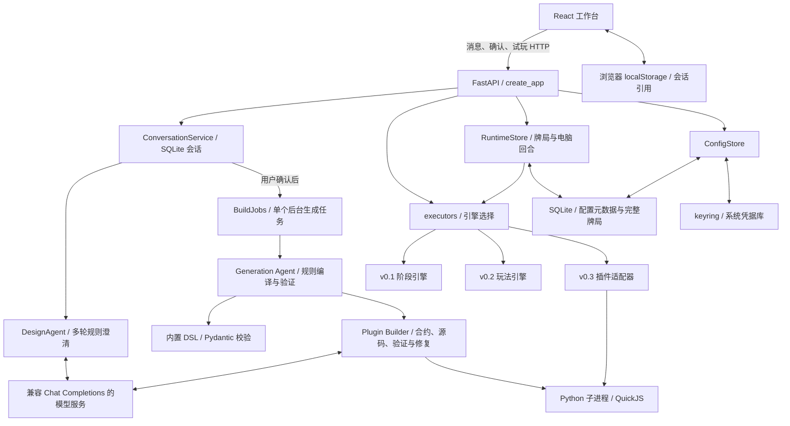
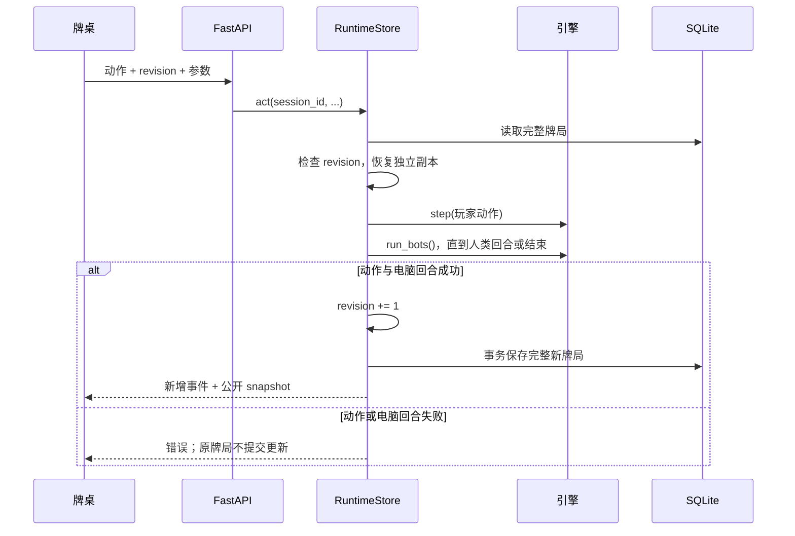

# Pocker Agent 项目架构

本文描述当前源码实现，逐步理解 Agent 请读 [Agent 运作机制](agent-workflow.md)。

Pocker Agent 是本机单用户的纸牌游戏设计工作台。用户描述玩法，模型协助澄清需求并产出规则配置或游戏代码，宿主程序执行校验，用户核对后可以模拟和试玩。游戏运行时由确定性引擎维护状态，正常出牌不调用大模型。

## 1. 系统组成与部署



前端使用 React、TypeScript、Vite，后端使用 Python、FastAPI、Pydantic。模型通信复用 OpenAI Python SDK，生成的 JavaScript 在 `quickjs-ng` 提供的 VM 中执行。项目没有独立消息队列、远程数据库或多人房间服务。

前端默认由 Vite 在 `5173` 端口提供。实际网络路径是：[api.ts](../frontend/src/api.ts) 默认直接请求 `http://127.0.0.1:8000`，可通过 `VITE_API_URL` 修改；[vite.config.ts](../frontend/vite.config.ts) 没有配置代理。后端 CORS 允许 `http://127.0.0.1:5173` 和 `http://localhost:5173`，纸牌资源由后端 `/assets` 提供。

[api.py](../src/pocker_agent/api.py) 的 `create_app()` 创建 `ConfigStore`、`RuntimeStore` 和 `BuildJobs`，注册路由及异常处理；模块级 `app = create_app()` 供 uvicorn 导入。导入应用时就会初始化数据目录和 SQLite 表。当前应用依赖进程内锁和任务字典，适用单进程部署；增加多个 worker 会使后台任务无法稳定被后续轮询找到，现有锁也不能协调多个进程。

## 2. 模块职责与依赖边界

| 层次 | 主要源码 | 职责 |
| --- | --- | --- |
| 工作台编排 | [main.tsx](../frontend/src/main.tsx) | 会话展示、提案确认、模拟、试玩、草稿恢复 |
| 前端请求 | [api.ts](../frontend/src/api.ts) | HTTP、公共类型、120 秒请求超时、下载与错误转换 |
| 模型设置 | [ModelSettings.tsx](../frontend/src/components/ModelSettings.tsx) | 临时配置、发现模型、测试连接、正式保存 |
| 牌桌呈现 | [GameTable.tsx](../frontend/src/components/GameTable.tsx)、[FamilyActions.tsx](../frontend/src/components/FamilyActions.tsx) | 牌面/牌背、动作按钮、算式输入、指定花色、插件动作 |
| HTTP 边界 | [api.py](../src/pocker_agent/api.py) | 输入模型、服务装配、接口、状态码 |
| 会话应用层 | [conversation.py](../src/pocker_agent/conversation.py) | 会话持久化、revision 与设计/提案/确认状态迁移 |
| Agent 编排 | [agent.py](../src/pocker_agent/agent.py) | 提示词、机制识别、澄清、DSL 提案、一次规则修复、调用代码构建器 |
| 模型协议 | [llm.py](../src/pocker_agent/llm.py)、[model_json.py](../src/pocker_agent/model_json.py) | 模型请求、流输出、超时、错误脱敏、完整 JSON 对象解析 |
| 规则合约 | [models.py](../src/pocker_agent/models.py)、[game_rules.py](../src/pocker_agent/game_rules.py)、[validation.py](../src/pocker_agent/validation.py) | 规则模型、字段及跨字段约束、`kind` 分发、中文条款 |
| 引擎入口 | [executors.py](../src/pocker_agent/executors.py) | 统一 `create_engine()` 和 `restore_engine()` |
| 内置执行器 | [engine.py](../src/pocker_agent/engine.py)、[family_engines.py](../src/pocker_agent/family_engines.py)、[arithmetic.py](../src/pocker_agent/arithmetic.py) | 阶段推进、计分、玩法状态机、AST 与 Fraction 精确算式校验/求解 |
| 代码生成 | [plugin_builder.py](../src/pocker_agent/plugin_builder.py)、[plugin_schema.py](../src/pocker_agent/plugin_schema.py) | 行为合约、固定场景、源码生成、错误反馈及有上限的修复 |
| 代码执行 | [plugin_sandbox.py](../src/pocker_agent/plugin_sandbox.py)、[plugin_worker.py](../src/pocker_agent/plugin_worker.py)、[plugin_engine.py](../src/pocker_agent/plugin_engine.py) | 子进程、QuickJS、状态守恒、插件到统一引擎的适配 |
| 后台任务 | [build_jobs.py](../src/pocker_agent/build_jobs.py) | 单并发任务、进度、完成/失败结果、有限内存记录 |
| 运行与模拟 | [runtime.py](../src/pocker_agent/runtime.py)、[simulation.py](../src/pocker_agent/simulation.py) | 玩家动作、电脑行动、revision、快照、模拟事件 |
| 持久化与配置 | [storage.py](../src/pocker_agent/storage.py)、[configuration.py](../src/pocker_agent/configuration.py) | SQLite 事务与连接、配置读写、系统凭据引用 |
| 离线导出 | [exporting.py](../src/pocker_agent/exporting.py) | 用阶段引擎预计算决策树，打包 HTML、DSL、牌面和许可证 |
| 能力声明 | [capabilities.py](../src/pocker_agent/capabilities.py) | `/api/capabilities` 的公开能力矩阵；执行约束仍由规则模型和引擎实施 |

`PlayableRule` 是各规则模型的联合类型。HTTP、Agent、模拟和试玩都围绕同一规则对象协作。`executors.py` 通过共同方法约定使用不同引擎，当前没有独立的 Engine Protocol/抽象接口文件。

## 3. 三种规则协议

DSL 是描述游戏规则的数据格式。模型填写 DSL 时，执行逻辑已经存在；代码生成路径则同时交付规则合约和新的 JavaScript 状态转换逻辑。

| 协议 | 分发标识 | 执行器 | 可表达内容 | 离线导出 |
| --- | --- | --- | --- | --- |
| v0.1 | `schema_version=0.1`，无 `kind` | `RuleEngine` | `play/discard/draw/pass`、阶段、轮次、最高牌/手牌数计分 | 固定 seed 的有限决策树 |
| v0.2 | `kind=arithmetic` | `ArithmeticEngine` | 单人四张牌算式练习，目标/牌值/运算符配置 | 不支持 |
| v0.2 | `kind=blackjack` | `BlackjackEngine` | 无下注 21 点，玩家对庄家、要牌/停牌 | 不支持 |
| v0.2 | `kind=shedding` | `SheddingEngine` | 同花/同点接牌、可选万能牌、2–4 人 | 不支持 |
| v0.3 | `kind=plugin` | `PluginEngine` → QuickJS | 固定 2–4 人、单局、JSON 状态与通用合法动作 | 不支持 |

`parse_rule()` 明确按 `kind` 选择模型；未知 `kind` 会报错。所有规则继承禁止额外字段的 `StrictSpec`，不能靠加入一个引擎不理解的字段就扩展能力。v0.1 的牌点强弱来自 `deck.ranks` 顺序；v0.2 则由对应玩法实现牌值和规则语义。

插件源码只提供 `setup(deck, playerCount, cards)`、`actions(state, cards)`、`step(state, action, cards)` 三个同步函数。源码随规则保存，不写入项目执行器文件，也不作为页面脚本运行。详情见 [生成游戏协议](generated-game-protocol.md)。

## 4. 从规则到牌局

新版页面把聊天请求和构建任务分开。每次发送先进入持久化 `ConversationService`，模型只负责多轮澄清；进入 `proposal_ready` 后，用户通过确认接口显式启动构建，构建完成才允许运行时操作：

1. `POST /api/conversations/{id}/messages` 追加聊天轮次；用户消息会先写入会话，模型调用在锁外执行。
2. `POST /api/conversations/{id}/confirm` 校验 `revision`，创建 `BuildJobs`；构建成功后会话进入 `playable`。
3. `POST /api/conversations/{id}/simulations` 调用 `simulate()` → `create_engine()` → `run()`，自动执行到结束或步数上限。
4. `POST /api/conversations/{id}/runtime` 创建 UUID 牌局；玩家动作携带当前 `revision`，服务端执行动作并接着执行电脑回合。
5. 返回公开快照，前端显示新的牌面、动作和结果；刷新后用会话中的 `runtime_id` 重新读取保存的牌局。

模拟不是试玩的强制前置步骤。页面要求先确认，但模拟和创建牌局接口直接接收规则对象，没有要求提交服务端“已确认提案 ID”。确认状态的具体归属见下一节。



`RuntimeStore.act()` 的锁覆盖读取、版本检查、执行和保存，`restore_engine()` 深拷贝事件及嵌套状态。一次人类请求即使带动多次电脑动作，也只增加一次 revision。重复提交旧 revision 返回 HTTP 409；这是冲突检测，并非按请求 ID 缓存结果的幂等协议。页面目前提供手动刷新牌局。

`run_bots()` 最多执行 10000 步。21 点的庄家行动直接在 `BlackjackEngine.settle()` 中完成，不依赖把当前玩家切到庄家再由通用循环驱动。

## 5. 状态与持久化

| 状态 | 所有者/位置 | 保存内容与恢复边界 |
| --- | --- | --- |
| 会话草稿 | 浏览器 localStorage | 只保存 `conversation_id`、输入框和 `runtime_id`；消息与规则以服务端为准 |
| 设计会话 | SQLite `conversations` 表 | `ConversationService` 保存消息、draft、phase、revision、request_id、构建结果与错误；服务重启会将未完成阶段标为 failed |
| 后台生成任务 | `BuildJobs.jobs` 内存字典 | 状态、进度、结果和错误；会话轮询会同步快照，后端重启后明确要求重试 |
| 正式模型配置 | SQLite `configuration` 表 | 单条配置 JSON：地址、模型 ID、`key_ref` |
| API Key | keyring/Windows 系统凭据库 | SQLite 与配置 GET 均不保存或返回 Key 明文；前端草稿不持久化 Key |
| 完整牌局 | SQLite `sessions` 表 | `id`、JSON `payload`；包含 engine 序列化、revision、seed；可跨后端重启恢复 |
| 插件验证缓存 | `accepted_program()` 的进程内 LRU | 完整规则及源码序列化作键，最多 32 条；重启失效；不是永久验收证书 |

默认数据库为 `%LOCALAPPDATA%\PockerAgent\pocker.db`，可用 `POCKER_AGENT_DATA_DIR` 改变目录。`storage.connect()` 使用 WAL、10 秒数据库连接等待、事务上下文和显式关闭连接。生产应用传入数据库路径；`RuntimeStore` 的纯内存分支主要供直接使用和测试。

存储的是完整状态快照，事件列表属于快照的一部分，没有独立事件表或事件溯源恢复系统。插件完整状态放在 `engine.extra.program_state` 中，包含 `hands/deck/discard/current_player/finished/winners/scores/phase/data`，所以 VM 销毁后仍能恢复后续动作。

`confirmed` 主要是工作台交互状态。虽然 `AgentSession` 也定义该字段与 `RuleAgent.confirm()`，当前 HTTP 确认路由直接校验请求，并不调用这个方法或持久化后端确认状态。前端收到一次正常返回的 Agent 结果后，会取消旧确认、清空旧模拟及试玩引用；若任务异常失败则保留原草稿。如果新输入需要澄清，返回的 `rules` 为空，页面也会清空当前提案，而已写入 SQLite 的旧牌局不会因此删除。

## 6. 模型配置、公开视图与执行约束

模型列表和连接测试使用临时配置，不改变正式配置。保存后再读取不可变的 `ModelConfig` 快照，为一次 Agent 请求创建模型客户端；后台任务启动后修改设置不改变该任务已持有的配置。空 Key 仅能复用同一规范化地址的现有凭据，切换地址必须填新 Key。

公开牌局由宿主 `snapshot()` 和各引擎 `view()` 生成。v0.1 保留展示全部手牌的 demo 模式；21 点在未结算时隐藏庄家暗牌及总点数；接牌和插件在未结束时隐藏其他玩家手牌。进行中的 21 点、接牌和插件快照不返回 seed。插件抽对手牌的位置动作由宿主重写为 `choice_N` 和位置标签，内部 `program_state` 不直接发送给牌桌。

QuickJS 执行仅交换 JSON。每次函数调用创建新 VM，未注册网络、文件、Shell、Python 回调或模块加载器，禁用 `Date` 和 `Math.random`；子进程仅继承少量系统/临时目录环境变量。每个 VM 有 32 MiB 内存、512 KiB 栈、0.2 秒执行时间限制，普通子进程操作墙钟 3 秒、整局模拟 12 秒。它是受限 VM，不是抵御原生 VM 漏洞的操作系统级隔离。

## 7. 接口速查

| 入口 | 职责 | 是否需要模型 |
| --- | --- | --- |
| `GET /health`、`GET /api/capabilities` | 健康与公开能力 | 否 |
| `GET/POST /api/agent/config` | 配置读取/保存 | 不发起推理 |
| `POST /api/agent/models` | 从临时配置发现模型 | 访问模型服务列表接口 |
| `POST /api/agent/test-connection` | 最小连接测试 | 是 |
| `POST /api/agent/jobs`、`GET /api/agent/jobs/{id}` | 页面使用的 Agent 任务入口与轮询 | 生成需要，查询不需要 |
| `POST /api/agent/turn` | 同步 Agent 入口，同一生成逻辑 | 是 |
| `POST /api/agent/confirm`、`POST /api/rules/validate` | 提案启动检查 / 仅解析校验 | 否 |
| `POST /api/simulations` | 全自动模拟 | 否 |
| `POST/GET /api/runtime/sessions...` | 创建/读取/执行牌局动作 | 否 |
| `POST /api/games/export` | v0.1 固定发牌 ZIP | 否 |

API 将 `stale_revision` 映射为 409，其他 `ValueError`/请求校验失败为 422，`RuntimeError` 为 502，SQLite 错误为 503，牌局查找的 `KeyError` 为 404。Agent 返回的 `kind=error` 和任务的 `status=failed` 也可能通过正常 HTTP 响应携带，前端必须同时检查业务状态。

离线导出用 `RuleEngine` 穷举人类合法选择，每步自动执行电脑动作，最多 2000 个决策节点。ZIP 包内的页面按预先算出的节点跳转，固定 `seed=7`，不在浏览器运行 Python 或生成式插件引擎。

## 8. 扩展时从哪里入手

| 目标 | 需要联动的模块 |
| --- | --- |
| 为已有玩法增加一个真实规则字段 | 规则模型与跨字段校验、执行器、`rule_facts()`、Agent 提示词、相关 UI 与规则测试 |
| 新增稳定内置玩法 | `game_rules.py` 模型/分发、`executors.py` 引擎映射、新执行器、前端 Rule/Runtime 类型与动作组件、能力矩阵、语义回归 |
| 改善澄清或 DSL 修复 | `RuleAgent.turn()`、`CONTRACT`、`_expected_family()`、`_repair()` |
| 改善生成代码成功率 | `PLAN_PROMPT`、`PROTOCOL`、合约校验、固定场景与宿主属性检查；明确测试阶段和源码修复阶段的边界 |
| 增加电脑策略 | 各引擎默认 `step()` 策略；保持合法性与可重复性，评估模拟/试玩路径差异 |
| 支持持久后台任务或多人联网 | 需要另行设计任务存储、跨进程协调、账号与房间、授权和实时同步；当前代码没有这些服务 |

推荐阅读顺序：`frontend/src/main.tsx` 的 `ask()` → `api.py` 的 `generate()` → `agent.py` 的 `turn()` → `plugin_builder.py` 或 `game_rules.py` → `executors.py` → `runtime.py` 的 `act()`。

## 9. 本次源码运行核对

2026-09-10 在 `E:\pocker agent` 的上述提交上使用现有 `.venv` 启动真实 uvicorn 服务，通过 HTTP 核对架构中的执行与恢复路径。源码通过 `--app-dir src` 加载；运行时为 Python 3.13.13、FastAPI 0.141.1、uvicorn 0.52.4、Pydantic 2.13.5、quickjs-ng 0.16.2.1、OpenAI SDK 3.8.0。

启动命令如下；运行脚本在子进程环境中清除了模型地址/模型/Key 环境变量，并设置独立数据目录 `E:\pocker agent\artifacts\architecture-smoke-20260910`，未改动用户正式配置与牌局。

```powershell
.\.venv\Scripts\python.exe -m uvicorn pocker_agent.api:app --app-dir src --host 127.0.0.1 --port 18080
```

实测 13 项检查通过：无模型配置时确认和模拟可用；v0.1 两轮比大小相同 seed 模拟结果一致；非法动作后数据库快照不变；玩家动作自动带动电脑并只增加一次 revision；旧 revision 返回 409；服务重启后普通牌局和插件牌局快照均一致且能继续到结算。插件使用仓库已有真实生成产物 `benchmarks/generated-old-maid.json`，确认时执行验证，重启后三次人类抽牌请求完成整局。

本次只修改文档，没有重新调用上游模型、重新生成插件或执行浏览器点击验收，也未将本次检查扩展为所有玩法的全面验收。现有自然语言/浏览器验收记录见 [生成游戏协议](generated-game-protocol.md) 与 [常见玩法审查](mainstream-games-review.md)。本机复现脚本和原始报告位于被 Git 忽略的 `artifacts/architecture-smoke.py`、`artifacts/architecture-smoke-20260910/report.json`；本节保留了可随文档提交的运行证据摘要。
