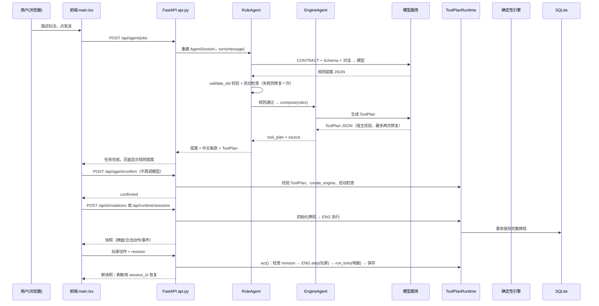

# 协作开发者指南：看懂架构图与游戏生成流程

本文面向第一次接触本仓库的协作开发者，配套交互式架构图一起阅读。

**架构图**（浏览器打开，可缩放/搜索/切换深浅色）：`E:\pocker agent\artifacts\pocker-agent-architecture.html`

```
自然语言 → RuleAgent 规则提案 → validate_dsl 校验 → EngineAgent ToolPlan
→ ToolPlanRuntime 校验执行 → 确定性引擎 → 事件与快照 → 前端
```

---

## 1. 架构图里每个部分是做什么的

架构图共 12 个节点，按"用户 → 前端 → 后端路由 → 生成链路 → 运行时 → 存储"组织。

### 用户与前端

| 节点 | 源码 | 职责 |
| --- | --- | --- |
| **用户** | — | 浏览器使用者：描述玩法、核对规则、点击试玩 |
| **前端工作台** `React + Vite :5173` | `frontend/src/main.tsx` | 整个工作台编排：玩法对话、任务轮询、规则确认、模拟、试玩、刷新恢复。草稿（对话/提案/任务 ID/牌局 ID）存浏览器 `localStorage` |
| （前端辅助） | `api.ts` / `ModelSettings.tsx` / `GameTable.tsx` / `FamilyActions.tsx` | HTTP 客户端与类型；模型配置面板（临时配置、发现模型、测试连接、保存）；牌桌与动作按钮渲染 |

### 后端路由与生成链路

| 节点 | 源码 | 职责 |
| --- | --- | --- |
| **FastAPI 路由** `api.py :8000` | `src/pocker_agent/api.py` | `create_app()` 装配 `ConfigStore`、`RuntimeStore`、`BuildJobs` 并注册全部路由。它不保存长期对话，只做输入校验、服务装配、状态码映射（旧 revision→409、业务错误→422、运行时→502、SQLite→503、找不到牌局→404） |
| **RuleAgent** `agent.py 澄清/生成/修复` | `src/pocker_agent/agent.py` | 对话与规则路由。识别玩法机制（`_expected_family()`）、构造提示词（`CONTRACT` + 对应 JSON Schema）、解析模型 JSON、校验 DSL、最多一次修复（`_repair()`）、启动检查、生成中文条款（`rule_facts()`）。**它是"自然语言 → 规则"的唯一入口** |
| **EngineAgent** `engine_agent.py ToolPlan` | `src/pocker_agent/engine_agent.py` | 把已确认的规则编译成 **ToolPlan**（工具调用计划）。模型选择并配置工具，宿主严格校验（工具白名单、必需工具、`game_kind`、玩家数），最多两次修复。返回 `tool_plan_source: "engine_agent"` |
| **模型服务** `OpenAI-compatible` | `src/pocker_agent/llm.py` | 统一模型客户端：OpenAI SDK、超时、流输出、错误脱敏（不泄露 Key）、完整 JSON 对象解析。可对接任意兼容 Chat Completions 的服务（OpenAI/中转站/本地部署） |

### 运行时与存储

| 节点 | 源码 | 职责 |
| --- | --- | --- |
| **ToolPlanRuntime** `runtime.py + GameLayer + 24 工具` | `src/pocker_agent/runtime.py`、`game_layer.py`、`tools/` | 当前运行时的核心。统一负责 ToolPlan 校验、工具白名单、初始化、回合执行和事件验证。`RuntimeStore.create/get/act` 全部经过它；调用未声明工具会报 `tool_not_declared`。同时承担 revision 并发保护、电脑回合（`run_bots()`）、快照生成 |
| **确定性引擎** `family/doudizhu/holdem` | `family_engines.py`（24点/21点/接牌）、`doudizhu_engine.py`、`holdem_engine.py` | 具体玩法状态机。它们是 ToolPlan 的"确定性执行适配器"，不能自行改变 Agent 的 ToolPlan。由 `executors.create_engine()` 按 `kind` 分发 |
| **插件沙箱** `QuickJS 生成（实验）` | `plugin_builder.py` / `plugin_sandbox.py` / `plugin_worker.py` / `plugin_engine.py` | 代码生成路径：先定行为合约和固定场景，再由模型写 JavaScript，在 QuickJS 子进程隔离执行（无网络/文件/随机数），状态守恒检查，失败反馈并最多两次源码修复。未通过测试不发布 |
| **SQLite** `storage.py 牌局与配置` | `src/pocker_agent/storage.py` | 持久化：完整牌局快照（sessions 表）+ 模型配置元数据（configuration 表）。WAL、事务上下文、显式关闭连接。默认 `%LOCALAPPDATA%\PockerAgent\pocker.db` |
| **系统凭据库** `keyring` | `src/pocker_agent/configuration.py` | API Key 存 Windows Credential Manager / 系统 keyring，SQLite 只保存 Key 引用，**不回退明文** |
| **离线导出** `exporting.py HTML/SVG/DSL` | `src/pocker_agent/exporting.py` | v0.1 阶段规则专用：用引擎预计算最多 2000 个决策节点的固定发牌练习包（HTML/SVG/DSL ZIP） |

### 未画进主图的支撑件

- **BuildJobs**（`build_jobs.py`）：单并发后台生成任务（页面发送走这里，同步 `/api/agent/turn` 复用同一逻辑），支持进度轮询、刷新续查。
- **simulation.py**：全自动模拟（`/api/simulations`），默认 seed=7，与试玩共用同一引擎。
- **capabilities.py**：`/api/capabilities` 公开能力矩阵。

---

## 2. 现在的架构是怎么"生成一个游戏"的

完整链路分 6 步，前 3 步是模型参与（需要配置模型服务），后 3 步不调用模型：



要点：

1. **发送**：前端 `ask()` 把 `message` + 历史 `messages` + 当前 `proposal` 发给 `/api/agent/jobs`，后台任务单并发运行。Agent 上下文**每次请求从客户端历史重建**，后端没有长期会话表。
2. **RuleAgent 生成规则**：模型返回 `proposal`（或 `question`/`unsupported`/`code`）。候选规则要过 `validate_dsl()`（Pydantic 严格模型、字段与跨字段约束、动作引用、牌组容量），机制不符或校验失败会带着错误**修复一次**；再执行 `create_engine(rules, seed=7).setup()` 真实启动检查。全部通过后生成中文条款。
3. **EngineAgent 生成 ToolPlan**：规则通过后（`agent.py:137`）由 EngineAgent 再次调用模型，把规则编译成"已注册工具调用计划"。模型只能选择/配置注册表里真实存在的工具，计划还要满足该玩法的必需工具集（如接牌需要 `deck/draw_discard/card_match/turn_order`，德州需要 `betting_round/phase_progress/community_deal/all_in/showdown/settle_pots`）。无效计划会带错误修复，最多两次。
4. **确认**：`/api/agent/confirm` **不调用模型**，只做提案校验 + ToolPlan 组装 + 运行时启动检查。
5. **模拟与试玩**：共用同一确定性引擎。模拟全自动；试玩时玩家动作携带当前 `revision`，服务端执行玩家动作后自动执行电脑回合直到轮到你或结束，每次只 `revision += 1`，整局写回 SQLite。重复提交旧 revision 返回 HTTP 409。
6. **刷新恢复**：浏览器从 localStorage 恢复草稿，用 `session_id` 从 SQLite 恢复牌局。

---

## 3. 端到端例子：生成一局德州扑克

以真实验收记录（`docs/holdem-browser-acceptance.md`、`scripts/validate_holdem_agent_runtime.py`）为例。

### 3.1 用户描述

> 创建两人德州扑克，起始筹码 100，小盲 5、大盲 10。

### 3.2 模型生成的规则（RuleAgent 产出，`kind=holdem`）

```json
{
  "schema_version": "0.2",
  "game_id": "agent-http-holdem",
  "title": "模型生成德州",
  "kind": "holdem",
  "max_rounds": 1,
  "deck": { "suits": ["S", "H", "D", "C"], "ranks": ["A", "2", ..., "K"] },
  "players": { "min_players": 2, "max_players": 2, "starting_hand_size": 2 },
  "starting_chips": 100,
  "small_blind": 5,
  "big_blind": 10,
  "streets": ["preflop", "flop", "turn", "river"],
  "actions": ["fold", "check", "call", "raise", "all_in"],
  "dealing": "two_private_and_community"
}
```

要点：**模型负责填写配置，引擎负责执行语义**。A 的 1/11、同花顺大小、摊牌比较、底池结算都不是模型逐张判断的，而是 `holdem_engine.py` 的确定性逻辑。

### 3.3 模型生成的 ToolPlan（EngineAgent 产出）

```json
{
  "schema_version": "1.0",
  "game_kind": "holdem",
  "players": 2,
  "tools": [
    { "name": "deck",  "config": { "ranks": [...], "suits": ["S","H","D","C"] } },
    { "name": "zones" },
    { "name": "pot",   "config": { "stacks": [100, 100] } },
    { "name": "betting_round",  "config": { "stacks": [100, 100], "min_raise": 10 } },
    { "name": "phase_progress", "config": { "phases": ["preflop","flop","turn","river"] } },
    { "name": "community_deal" },
    { "name": "all_in" },
    { "name": "showdown" },
    { "name": "settle_pots" },
    { "name": "hand_rank", "config": { "best_of": 7 } }
  ],
  "phases": ["preflop", "flop", "turn", "river"],
  "actions": [
    { "tool": "deck", "operation": "deal", "args": { "seed": 0, "hands": 2, "cards_each": 2 }, "result_key": "deal" }
  ],
  "end_conditions": ["phase_progress.finished", "all_in.runout_required", "showdown.completed"]
}
```

这是**运行时将要执行什么**的契约：发两张底牌、下注轮、发公共牌、摊牌、结算。宿主校验它之后才允许运行——这就是"Agent 生成计划、Runtime 按计划执行"，而不是绕过计划直接启动硬编码引擎。

### 3.4 确认 → 模拟 → 试玩

- `POST /api/agent/confirm`：校验上述 rules + tool_plan，`create_engine(rules, seed=7, tool_plan=...)` 启动，事件验证通过 → `confirmed`。
- `POST /api/simulations`：全自动打完整手牌。
- `POST /api/runtime/sessions`：创建试玩会话。人类是 `player-1`，其他玩家由电脑自动行动。
- 页面点击动作：**跟注 → 翻牌过牌 → 转牌过牌 → 河牌过牌**。页面依次显示 3、4、5 张公共牌并完成摊牌结算。
- 展开"本局事件"，看到的真实工具调用序列（浏览器验收记录）：

```text
deck.deal
betting_round.act
all_in.check
phase_progress.advance
community_deal.deal
showdown.call
settle_pots.call
```

这些事件证明：**浏览器里的每一次点击都真实经过 HTTP 运行时，实际执行的是 ToolPlan 中声明的工具**，不是前端模拟或硬编码流程。

- 刷新浏览器：显示"已恢复上次牌局"，结算结果、公共牌、事件与筹码都还在（SQLite 完整快照）。

---

## 4. 关键机制速查

| 机制 | 位置 | 说明 |
| --- | --- | --- |
| 工具注册表 | `src/pocker_agent/tools/registry.py` | 约 24 个已注册工具（deck/zones/betting_round/card_match/turn_order/...），ToolPlan 只能引用这些名字 |
| ToolPlan 校验 | `runtime.py` ToolPlanRuntime、`api.py /api/tools/plan/validate` | 白名单、必需工具、`game_kind` 匹配、玩家数；运行时调用未声明工具报 `tool_not_declared` |
| revision 并发保护 | `runtime.py RuntimeStore.act()` | 锁覆盖读-查-执行-保存；旧 revision 返回 409；一次人类请求只 +1 |
| 电脑行动 | `runtime.py run_bots()`（上限 10000 步）+ 各引擎策略 | 合法动作策略，可脱离模型运行；确定性可重复，不保证高棋力 |
| 规则校验 | `validation.py validate_dsl()` | Pydantic 严格模型（拒绝未知字段）+ 跨字段/容量/动作引用检查 |
| DSL 修复 | `agent.py _repair()` | 最多一次，携带错误与用户对话回送模型 |
| ToolPlan 修复 | `engine_agent.py compose()` | 最多两次，附 `plan_for_rules()` 同玩法工具配置范例 |
| 代码生成验证 | `plugin_builder.py` | 固定场景 + 三种子重放 + 状态守恒；`verify_old_maid.py` 是独立人工 oracle |
| 错误映射 | `api.py` 异常处理 | 409/422/502/503/404；业务 `kind=error` 走正常 HTTP 响应，前端须双检查 |

---

## 5. 常见开发任务的入口

| 想做什么 | 从哪里入手 |
| --- | --- |
| 追一次"发送"的完整路径 | `frontend/src/main.tsx: ask()` → `api.py: generate()` → `agent.py: turn()` → `engine_agent.py: compose()` → `runtime.py: act()` |
| 给已有玩法加一个真实规则字段 | 规则模型 + 跨字段校验 + 执行器 + `rule_facts()` + Agent 提示词 + 前端类型与动作组件 + 测试 |
| 新增稳定内置玩法 | `game_rules.py` 模型/分发 + `executors.py` 映射 + 新执行器 + 前端 Runtime/动作组件 + 能力矩阵 |
| 提高真实模型生成成功率 | `engine_agent.py` 修复提示与 `_normalize_gateway_plan()`；已知 deepseek-flash 约 80% 首轮有效 |
| 增加电脑策略 | 各引擎默认策略；保持合法性与可重复性 |
| 多人联网 / 持久任务队列 | 当前是单进程设计，需另行设计任务存储、跨进程协调、账号房间与实时同步 |

---

## 6. 部署与启动

```powershell
# 后端（本机单用户单进程）
uv run uvicorn pocker_agent.api:app --app-dir src --host 127.0.0.1 --port 8000

# 前端
cd frontend && npm ci && npm run dev -- --host 127.0.0.1
```

模型配置在页面"模型设置"填写（兼容 Chat Completions 的地址/Key/模型），或通过 `POCKER_AGENT_BASE_URL / POCKER_AGENT_API_KEY / POCKER_AGENT_MODEL` 环境变量提供初始值。Key 存系统凭据库。

**重要边界**：本机单用户单进程；代码生成（QuickJS）是实验能力，不等于任意玩法都已支持；离线导出只覆盖 v0.1 阶段规则、固定 seed、最多 2000 决策节点。多人联网、下注/复杂牌型、账号隔离不在当前范围。
